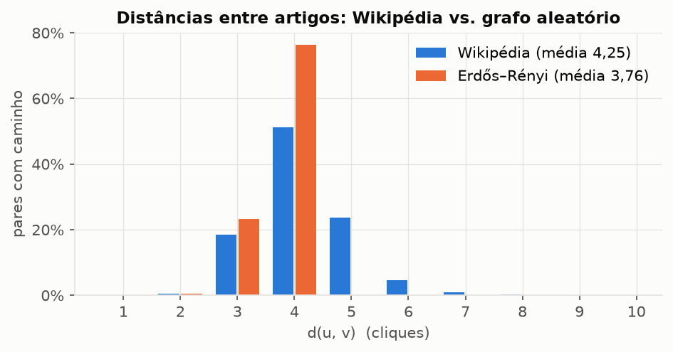
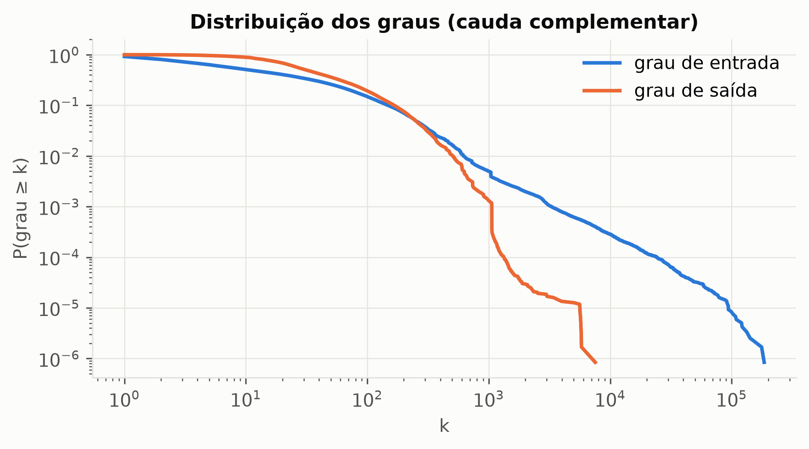
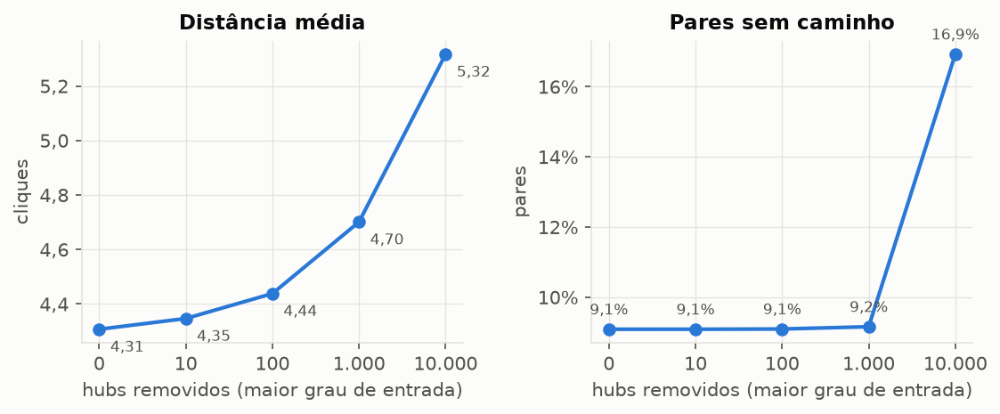
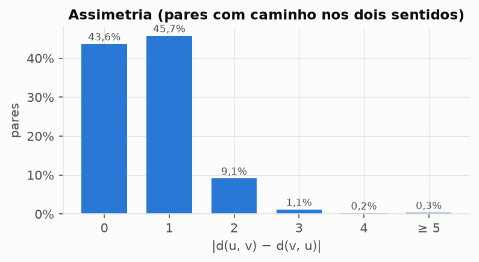

# Wikirace: busca exata contra inteligência artificial na Wikipédia

**Matemática Discreta — trabalho final** · grafo da Wikipédia em português (dump de 01/11/2026)

## 1. Pergunta

No Wikirace o jogador sai de um artigo e tenta chegar em outro só clicando em
links. Queremos medir **quanto se perde, em cliques, ao trocar a busca exata
(BFS) por agentes que escolhem links "por intuição"**, e **quanto cada um
precisa explorar**. As provas dos teoremas citados estão no Apêndice A; todo o
código está em `wikirace/` e cada número deste relatório sai de um script em
`scripts/` (ver o README).

## 2. Dados e modelagem

A Wikipédia em português vira um grafo dirigido $G = (V, E)$: vértices são os
artigos (domínio principal, sem páginas de redirecionamento) e há uma aresta
$u \to v$ se o texto de $u$ tem um link para $v$. Montamos o grafo a partir dos
dumps oficiais (`page`, `redirect`, `linktarget`, `pagelinks`), com estas regras:

* link para um redirecionamento vira link para o artigo final (seguindo cadeias);
* links vermelhos, para outros domínios ou para redirecionamentos quebrados são descartados;
* laços e arestas repetidas são removidos.

| | |
|---|---|
| artigos $\lvert V \rvert$ | 1.187.101 |
| links $\lvert E \rvert$ | 80.389.152 |
| grau médio $\lvert E \rvert / \lvert V \rvert$ | 67,7 |
| mediana do grau de entrada / saída | 10 / 31 |
| artigos sem nenhum link de entrada | 91.644 |
| artigos sem nenhum link de saída | 611 |

O grafo fica em formato CSR (dois vetores, `indptr` e `indices`, ~330 MB) e a
BFS bidirecional responde em milissegundos. O exemplo da proposta sai igual:
**Pelé → Inglaterra → Mecânica quântica** (2 cliques).

**Lema do aperto de mãos, conferido:** $\sum_v \deg^+(v) = \sum_v \deg^-(v) = 80.389.152 = |E|$.

## 3. Estrutura do grafo

### 3.1 Conectividade

Calculamos as componentes fortemente conexas com um Kosaraju implementado por
nós (26 s no grafo inteiro; dá exatamente a mesma partição que o
`scipy.sparse.csgraph`).

* Há **101.368 CFCs**, mas a maior tem **1.078.919 artigos (90,9%)**; a
  segunda maior tem só 167. São 98.893 componentes de um vértice só.
* O grafo das componentes (101.368 vértices, 109.339 arestas) é **acíclico**,
  como o resultado do Apêndice A.4 garante (conferido com o algoritmo de Kahn).
* Em relação à componente gigante (estrutura "gravata-borboleta"):

| parte | artigos | o que é |
|---|---:|---|
| CFC gigante | 1.078.919 | alcançam e são alcançados por todos da CFC |
| IN | 107.564 | chegam na CFC, mas ninguém da CFC chega neles |
| OUT | 302 | alcançados pela CFC, mas sem volta |
| outros | 316 | nem uma coisa nem outra |

Quase tudo que fica de fora está em **IN**: artigos que linkam para o resto,
mas que **ninguém linka** — muitas páginas de desambiguação ("Abel
(desambiguação)", "Cunha (desambiguação)"), listas ordenadas e artigos órfãos.
Por isso **9,1% dos pares $(u, v)$ não têm caminho**: o problema quase sempre é
o destino, não a origem.

### 3.2 Mundo pequeno

Rodamos BFS completas a partir de 60 artigos sorteados (cada uma dá a distância
para todos os 1,19 milhão de destinos: 71 milhões de pares) e fizemos o mesmo num
grafo de Erdős–Rényi dirigido com os mesmos $|V|$ e $|E|$.

| | Wikipédia | Erdős–Rényi |
|---|---:|---:|
| distância média (pares com caminho) | **4,25** | 3,76 |
| mediana | 4 | 4 |
| 90% dos pares com $d \le$ | 5 | 4 |
| maior distância vista | 208 | 5 |
| pares sem caminho | 9,1% | 0% |

70% dos pares estão a no máximo 4 cliques e 98,6% a no máximo 6: é um mundo
pequeno. O **limite de Moore** dá a ordem de grandeza: com $\Delta \approx 100$
links por artigo, $\log_{100} 1{,}19 \cdot 10^6 \approx 3{,}0$; com o grau médio
real, $\ln n / \ln 67{,}7 \approx 3{,}3$, que é o que o Erdős–Rényi faz (3,76).

O curioso é que a Wikipédia é **um pouco mais longa** que o grafo aleatório,
apesar dos hubs. A explicação está no grau de entrada: a mediana é 10 (contra
~68 no aleatório). Os hubs encurtam o começo da corrida, mas o último passo
tem que entrar por um dos poucos artigos que linkam o destino. E há uma cauda
longa: cadeias de artigos que só linkam o próximo da série (a maior distância
vista foi 208), que no aleatório não existem.

### 3.3 Hubs

Os graus de entrada têm cauda pesada (a curva fica quase reta na escala
log-log por várias ordens de grandeza). O grau de saída é limitado pelo tamanho
dos artigos e cai bruscamente perto de 1.000 (artigos com caixas de navegação
grandes) e ~5.700 (listas gigantes).

| maiores graus de entrada | | maiores graus de saída | |
|---|---:|---|---:|
| Estados Unidos | 185.206 | Lista de objetos NGC | 7.527 |
| Brasil | 176.369 | Lista de municípios do Brasil por PIB | 5.802 |
| Densidade populacional | 141.746 | ... por PIB (2016) | 5.780 |
| International Standard Book Number | 132.770 | ... por PIB (2015) | 5.773 |
| Base Virtual Internacional de Autoridade | 121.918 | ... por PIB per capita | 5.734 |
| Território | 120.512 | | |
| França | 109.142 | | |

Vários hubs de entrada são "links de infraestrutura" vindos de predefinições
(ISBN, controle de autoridade, densidade populacional, metro quadrado), não de
conteúdo.

**Removendo hubs.** Tiramos os $k$ artigos de maior grau de entrada (fazendo a
BFS ignorar esses vértices) e medimos de novo, com 30 fontes:

Tirar os 100 maiores hubs quase não muda nada (4,31 → 4,44). Com 10.000
removidos — só 0,84% dos artigos — a distância média sobe para 5,32 e os
pares sem caminho quase dobram (9,1% → 16,9%): os hubs não são essenciais
individualmente, mas o conjunto deles é o que segura o mundo pequeno.

### 3.4 Assimetria

Para 40 fontes $s$, uma BFS em $G$ dá $d(s, \cdot)$ e uma no transposto dá
$d(\cdot, s)$, então comparamos $d(s, v)$ com $d(v, s)$ em 47 milhões de pares que
têm caminho em pelo menos um sentido:

* **37,8%** têm $d(u, v) = d(v, u)$;
* **48,9%** têm caminho nos dois sentidos, mas com tamanhos diferentes;
* **13,2%** só têm caminho num sentido ($d = \infty$ do outro lado).

Entre os pares com caminho nos dois sentidos, a diferença é quase sempre
pequena (89% diferem em no máximo 1 clique). Ou seja, $d$ é uma quase-métrica
de verdade (Apêndice A.4): a desigualdade triangular vale sempre, mas a simetria
falha na maioria dos pares.

<!-- BONUS -->

<!-- EXPERIMENTO -->

## Apêndice A — Provas

Notação: $G = (V, E)$ é um grafo dirigido finito, $d(u, v)$ é o menor número de
arestas de um caminho de $u$ até $v$ ($\infty$ se não existe), $N^+(u)$ são os
vizinhos de saída de $u$ e $\deg^+(u) = |N^+(u)|$, $\deg^-(u)$ o grau de entrada.

### A.1 Correção da BFS

O algoritmo (arquivo `wikirace/busca.py`, função `bfs`): começa com
$\text{dist}[s] = 0$ e $s$ na fila; enquanto a fila não está vazia, tira $u$ da
frente e, para cada $v \in N^+(u)$ ainda sem distância, faz
$\text{dist}[v] = \text{dist}[u] + 1$, $\text{pai}[v] = u$ e põe $v$ no fim da fila.

**Lema 1 (a distância calculada é de um caminho de verdade).** Se $\text{dist}[v]$
foi definido, seguindo os pais de $v$ chegamos em $s$ por um caminho com
$\text{dist}[v]$ arestas. Logo $\text{dist}[v] \ge d(s, v)$.

*Prova.* Indução na ordem em que os vértices recebem distância. Para $s$ vale
(caminho vazio). Quando $v$ recebe $\text{dist}[u] + 1$ via a aresta $u \to v$,
por hipótese existe caminho de $s$ até $u$ com $\text{dist}[u]$ arestas; somando
$u \to v$ temos um com $\text{dist}[u] + 1$. Como $d(s, v)$ é o mínimo sobre todos os
caminhos, $\text{dist}[v] \ge d(s, v)$. $\blacksquare$

**Lema 2 (a fila está "quase ordenada").** Se a fila é $v_1, \dots, v_r$ (com $v_1$
na frente), então $\text{dist}[v_1] \le \text{dist}[v_2] \le \dots \le \text{dist}[v_r] \le \text{dist}[v_1] + 1$.

*Prova.* Indução no número de operações. Vale com a fila $[s]$. Ao tirar $v_1$, a
sequência restante continua ordenada e $\text{dist}[v_r] \le \text{dist}[v_1] + 1 \le \text{dist}[v_2] + 1$.
Ao inserir $v$ enquanto processamos $u = v_1$ (já retirado), $\text{dist}[v] = \text{dist}[u] + 1$;
como $\text{dist}[v_r] \le \text{dist}[u] + 1 = \text{dist}[v]$ a ordem se mantém, e para
o novo primeiro $v_1'$ temos $\text{dist}[u] \le \text{dist}[v_1']$, logo
$\text{dist}[v] = \text{dist}[u] + 1 \le \text{dist}[v_1'] + 1$. $\blacksquare$

Consequência: os valores de $\text{dist}$ dos vértices retirados da fila nunca
diminuem com o tempo.

**Teorema 1.** Ao final da BFS, $\text{dist}[v] = d(s, v)$ para todo $v$ (com
$\text{dist} = \infty$ exatamente nos inalcançáveis), e para todo $v$ alcançável os
pais formam um caminho mínimo de $s$ até $v$. O tempo é $O(|V| + |E|)$.

*Prova (indução no nível $k = d(s, v)$).* Se $v$ é inalcançável, o Lema 1 mostra
que ele nunca recebe distância. Suponha por absurdo que existe $v$ alcançável
com $\text{dist}[v] \ne d(s, v)$ e escolha um com $k = d(s, v)$ mínimo. Como
$\text{dist}[s] = 0$, $v \ne s$ e $k \ge 1$. Seja $u$ o vértice antes de $v$ num
caminho mínimo; $d(s, u) = k - 1$ e, pela minimalidade, $\text{dist}[u] = k - 1$
(em particular $u$ entra e sai da fila). Pelo Lema 1, $\text{dist}[v] > k$. No
momento em que $u$ sai da fila e olha a aresta $u \to v$:

* se $v$ ainda não tinha distância, recebe $k$ — contradição;
* se $v$ já tinha saído da fila antes de $u$, pela consequência do Lema 2,
  $\text{dist}[v] \le \text{dist}[u] = k - 1$ — contradição;
* se $v$ estava na fila, pelo Lema 2, $\text{dist}[v] \le \text{dist}[u] + 1 = k$ — contradição.

Portanto $\text{dist}[v] = d(s, v)$. O caminho pelos pais tem
$\text{dist}[v] = d(s, v)$ arestas (Lema 1), logo é mínimo. Para o tempo: cada
vértice entra na fila no máximo uma vez (só entra quando recebe distância, o que
acontece uma vez), e a lista de adjacência de cada vértice é percorrida uma vez
quando ele sai, somando $\sum_u (1 + \deg^+(u)) = |V| + |E|$ operações. $\blacksquare$

A `bfs_niveis` (versão vetorizada) expande a fronteira inteira de uma vez; a
fronteira do passo $k$ é exatamente $\{v : \text{dist}[v] = k\}$, que é a mesma
coisa que a BFS com fila faz "em blocos", então o Teorema 1 vale igual. Os
testes conferem as duas contra Floyd–Warshall em grafos aleatórios.

### A.2 Correção da BFS bidirecional

Duas buscas: a da frente, a partir de $s$ em $G$, e a de trás, a partir de $t$ no
grafo transposto $G^T$ (onde $d_{G^T}(t, v) = d_G(v, t)$). A cada passo
escolhemos um lado e expandimos **um nível inteiro** dele; o algoritmo para no
primeiro vértice descoberto que já tinha sido visto pelo outro lado.

Sejam $F_i = \{v : d(s, v) \le i\}$ e $B_j = \{v : d(v, t) \le j\}$. Pelo Teorema 1,
depois de a frente completar $i$ níveis, os vértices visitados por ela são
exatamente $F_i$ (e analogamente $B_j$ atrás), e os pais dão caminhos mínimos.

**Lema 3.** Se $F_i \cap B_j = \emptyset$, então $d(s, t) > i + j$.

*Prova.* Suponha $D = d(s, t) \le i + j$ e tome um caminho mínimo
$s = x_0, x_1, \dots, x_D = t$. Seja $x = x_{\min(i, D)}$. Então
$d(s, x) \le \min(i, D) \le i$ e, como subcaminho de caminho mínimo é mínimo,
$d(x, t) = D - \min(i, D) \le j$ (se $D \le i$ é $0$; senão é $D - i \le j$).
Logo $x \in F_i \cap B_j$. $\blacksquare$

**Teorema 2.** A BFS bidirecional devolve um caminho mínimo de $s$ até $t$, ou
"sem caminho" se $d(s, t) = \infty$.

*Prova.* Se $s = t$ devolve o caminho vazio. Senão, considere o momento em que
o primeiro encontro acontece. Sem perda de generalidade a frente está
expandindo o nível $i \to i + 1$ e o lado de trás completou $j$ níveis (o outro
caso é simétrico). Até ali não houve encontro, então $F_i \cap B_j = \emptyset$ e,
pelo Lema 3, $D \ge i + j + 1$. O vértice $v$ do encontro foi descoberto agora,
logo $d(s, v) = i + 1$, e está em $B_j$, logo $d(v, t) \le j$. O caminho devolvido
(pais da frente até $v$, depois "pais" de trás até $t$) tem
$d(s, v) + d(v, t) \le i + 1 + j \le D$ arestas. Mas todo caminho de $s$ a $t$ tem
pelo menos $D$ arestas, então tem exatamente $D$: é mínimo.

Se um dos lados esvazia a fronteira sem encontro — digamos a frente, no nível
$i$ —, então $F_i$ é tudo que $s$ alcança e é disjunto de $B_j \ni t$, logo $t$
não é alcançável. $\blacksquare$

Observação: o teorema vale **parando no meio do nível**, no primeiro encontro.
O que é essencial é que a outra busca esteja com o nível completo — e está,
porque só um lado é expandido por vez.

### A.3 Otimalidade do A* (e do A* ponderado)

O A* mantém uma fila de prioridade com $f(v) = g(v) + w\,h(v)$, onde $g(v)$ é o
melhor custo conhecido de $s$ até $v$ e $w \ge 1$. Tira o vértice de menor $f$; se
for $t$, para; senão, para cada vizinho $x$, se $g(u) + 1 < g(x)$ atualiza
$g(x)$, o pai, e (re)coloca $x$ na fila. Uma heurística é **admissível** se
$h(v) \le d(v, t)$ para todo $v$ (e então $h(t) = 0$).

**Lema 4.** Enquanto $t$ não foi retirado, para qualquer caminho mínimo
$P = (s = n_0, \dots, n_D = t)$ existe um vértice $n_k$ de $P$ na fila com
$g(n_k) = k = d(s, n_k)$.

*Prova.* Seja $k$ o maior índice com $g(n_k) = k$ (existe, pois $g(s) = 0$). Quando
$g(n_k)$ ficou igual a $k$, $n_k$ foi colocado na fila com esse valor. Se ele já
tivesse sido retirado com $g = k$, ao expandi-lo teríamos $g(n_{k+1}) \le k + 1$ e,
como $g$ nunca fica menor que a distância real (é custo de um caminho de
verdade), $g(n_{k+1}) = k + 1$, contrariando a maximalidade de $k$. (Se $k = D$,
$n_k = t$ ainda não foi retirado por hipótese.) Logo $n_k$ está na fila com
$g(n_k) = k$. $\blacksquare$

**Teorema 3.** Se $h$ é admissível e $w \ge 1$, o A* com $f = g + w\,h$ devolve
um caminho de comprimento no máximo $w \cdot d(s, t)$. Em particular, com $w = 1$
o caminho é mínimo.

*Prova.* Seja $D = d(s, t) < \infty$. No momento em que $t$ é retirado, um
instante antes vale o Lema 4: existe $n$ na fila, num caminho mínimo, com
$g(n) = d(s, n)$. Como $t$ foi escolhido em vez de $n$, e $h(t) = 0$:

$$
g(t) = f(t) \le f(n) = d(s, n) + w\,h(n) \le d(s, n) + w\,d(n, t)
\le w\,\big(d(s, n) + d(n, t)\big) = w\,D.
$$

O caminho devolvido (pelos pais) tem exatamente $g(t)$ arestas. Com $w = 1$,
$g(t) \le D$ e, sendo caminho, $g(t) \ge D$. O algoritmo termina porque cada
vértice só volta para a fila quando seu $g$ (inteiro, $\ge 0$) diminui. $\blacksquare$

**A heurística usada.** Com embeddings normalizados, $\cos(v, t) \in [-1, 1]$ e
definimos

$$
h(v) = \frac{1 - \cos(v, t)}{2} \in [0, 1], \qquad h(t) = 0.
$$

Para $v \ne t$ alcançável, $d(v, t) \ge 1 \ge h(v)$: **$h$ é admissível** (e até
consistente, pois $h(u) \le 1 \le 1 + h(x)$ em toda aresta $u \to x$). O preço é
que ela é fraca: como nunca passa de $1$, ela só "desempata" vértices com o
mesmo $g$. Para deixar a semântica guiar de verdade, é preciso multiplicar por
$w > 1$ — e aí $w\,h$ **deixa de ser admissível** (para $w = 8$, um vizinho do
destino pode ter $w\,h = 8 > 1 = d$). O Teorema 3 ainda garante o limite
$w \cdot \text{ótimo}$, e o experimento mede quanto do limite é usado na prática.

### A.4 Resultados de apoio

**Alcançar mutuamente é relação de equivalência.** Defina $u \sim v$ se
$d(u, v) < \infty$ e $d(v, u) < \infty$. Reflexiva: $d(u, u) = 0$. Simétrica: a
definição é simétrica. Transitiva: se $u \sim v$ e $v \sim x$, concatenando um
caminho $u \to v$ com um $v \to x$ temos um passeio (e, tirando repetições, um
caminho) de $u$ a $x$; o mesmo no sentido contrário. As classes são as
**componentes fortemente conexas** (CFCs).

**O grafo das componentes é acíclico.** Contraia cada CFC num vértice, com aresta
$C \to C'$ se existe $u \in C$, $v \in C'$, $u \to v$. Se houvesse um ciclo
$C_1 \to C_2 \to \dots \to C_r \to C_1$ com $r \ge 2$, todo vértice de $C_1$
alcançaria todo vértice de $C_2$ e vice-versa (andando pelo ciclo e dentro de
cada componente), logo $C_1 = C_2$ — contradição.

**$d$ é uma quase-métrica.** (i) $d(u, v) \ge 0$ e $d(u, v) = 0 \iff u = v$;
(ii) desigualdade triangular $d(u, x) \le d(u, v) + d(v, x)$: concatenar caminhos
mínimos $u \to v$ e $v \to x$ dá um passeio de $u$ a $x$ com esse comprimento, e
o mínimo não pode ser maior. (iii) A simetria falha: basta uma aresta $u \to v$
sem a volta, e.g. $u \to v \to x \to u$ dá $d(u, v) = 1$ e $d(v, u) = 2$.

**Lema do aperto de mãos dirigido.** $\sum_v \deg^+(v) = \sum_v \deg^-(v) = |E|$:
contando os pares $(u, v)$ com $u \to v \in E$ agrupando pela origem obtemos a
primeira soma, agrupando pelo destino a segunda; as duas contam cada aresta
uma vez.

**Limite de Moore.** Se todo vértice tem $\deg^+ \le \Delta$, a partir de $s$ há no
máximo $\Delta^i$ vértices a distância exatamente $i$, então

$$
|\{v : d(s, v) \le k\}| \le 1 + \Delta + \dots + \Delta^k = \frac{\Delta^{k+1} - 1}{\Delta - 1}.
$$

Para alcançar $n$ vértices é preciso $\frac{\Delta^{k+1} - 1}{\Delta - 1} \ge n$, ou
seja $k \gtrsim \log_\Delta n - 1 + \log_\Delta(\Delta - 1) \approx \log_\Delta n$. Com
$n \approx 1{,}19 \cdot 10^6$ e $\Delta \approx 100$: $\log_{100} n \approx 3{,}04$.

**Grafos funcionais.** Seja $f : V \to V$ ("clicar no primeiro link"), com $V$
finito. A sequência $v, f(v), f^2(v), \dots$ tem $|V| + 1$ termos entre
$f^0(v)$ e $f^{|V|}(v)$, mas só $|V|$ valores possíveis: pela **casa dos pombos**
dois são iguais, $f^a(v) = f^b(v)$ com $a < b$, e a partir daí a sequência é
periódica — entra num ciclo. Além disso, cada componente (fracamente conexa)
do grafo de $f$ tem **exatamente um** ciclo: tem pelo menos um (itere $f$ a
partir de qualquer vértice dela; a sequência nunca sai da componente) e, se
a componente tem $c$ vértices, ela tem exatamente $c$ arestas (uma saindo de
cada vértice); um grafo conexo com $c$ vértices e $c$ arestas é uma árvore
geradora ($c - 1$ arestas) mais uma aresta, que fecha exatamente um ciclo.
(Na Wikipédia $f$ é parcial — há artigos sem link no texto —; as componentes
que contêm um desses vértices não têm ciclo.)

**Contraexemplo para o guloso.** No grafo
$s \to a \to x \to y \to t$, $s \to b \to t$, com $a, x, y$ "parecidos" com $t$ e
$b$ não, o guloso semântico vai de $s$ para $a$ e usa 4 cliques, enquanto o ótimo
é 2 (via $b$). O A* com $w = 1$ acha o caminho de 2. É exatamente o teste
`test_contraexemplo_do_guloso` em `tests/test_agentes.py`.
